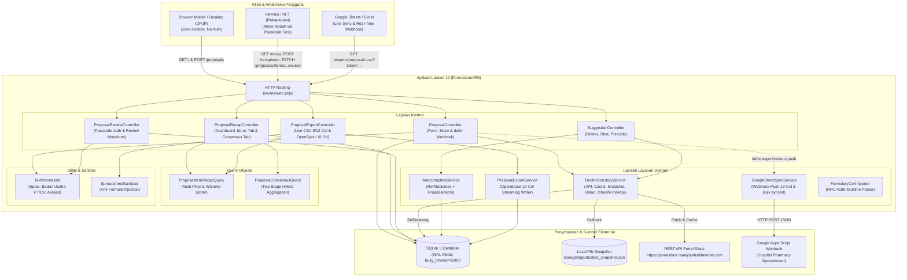
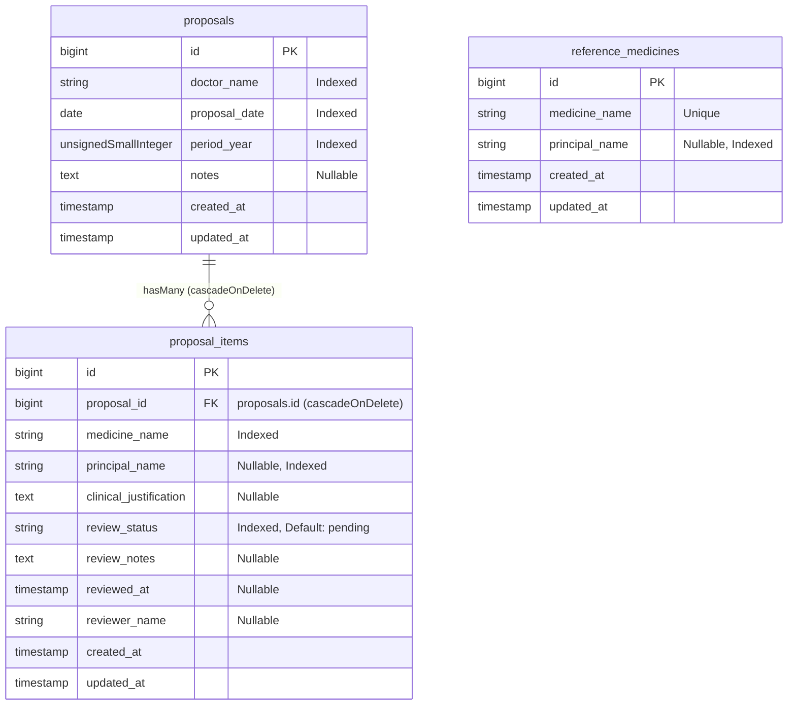

# Dokumentasi Teknis & Panduan Sistem
## Sistem Usulan Obat Formularium RS (RS Aisyiyah Siti Fatimah Tulangan)

Dokumen ini menyajikan panduan arsitektur komprehensif, spesifikasi teknis, mekanisme kerja domain, kamus data, panduan operasional, hingga catatan rilis dan pengujian untuk **Sistem Usulan Obat Formularium RS Aisyiyah Siti Fatimah Tulangan** hingga rilis **v1.2.1**.

---

## Daftar Isi

- [1. Pendahuluan & Latar Belakang](#1-pendahuluan--latar-belakang)
  - [1.1 Konteks Operasional](#11-konteks-operasional)
  - [1.2 Masalah yang Diselesaikan](#12-masalah-yang-diselesaikan)
  - [1.3 Sasaran Sistem (*Key Objectives*)](#13-sasaran-sistem-key-objectives)
- [2. Arsitektur Sistem](#2-arsitektur-sistem)
  - [2.1 Diagram Arsitektur Komponen](#21-diagram-arsitektur-komponen)
  - [2.2 Stack Teknologi](#22-stack-teknologi)
- [3. Skema Basis Data & Konvensi](#3-skema-basis-data--konvensi)
  - [3.1 Entity Relationship Diagram (ERD)](#31-entity-relationship-diagram-erd)
  - [3.2 Tabel `proposals`](#32-tabel-proposals)
  - [3.3 Tabel `proposal_items`](#33-tabel-proposal_items)
  - [3.4 Tabel `reference_medicines`](#34-tabel-reference_medicines)
- [4. Mekanisme & Alur Kerja Komponen Inti](#4-mekanisme--alur-kerja-komponen-inti)
  - [4.1 Formulir Usulan Dokter & Fitur UX Form Mobile (`proposals.create`)](#41-formulir-usulan-dokter--fitur-ux-form-mobile-proposalscreate)
  - [4.2 Pencegahan Double-Submit & Pendorongan Zero-Latency via `defer()`](#42-pencegahan-double-submit--pendorongan-zero-latency-via-defer)
  - [4.3 Ketahanan Direktori Dokter & Sinkronisasi API (`DoctorDirectoryService`)](#43-ketahanan-direktori-dokter--sinkronisasi-api-doctordirectoryservice)
  - [4.4 Autocomplete Hibrida & Self-Learning Obat (`AutocompleteService`)](#44-autocomplete-hibrida--self-learning-obat-autocompleteservice)
  - [4.5 Dashboard Rekapitulasi & Sorting Interaktif Multi-Kolom (`proposals.index`)](#45-dashboard-rekapitulasi--sorting-interaktif-multi-kolom-proposalsindex)
  - [4.6 Analitik Konsensus Usulan Obat Sidang KFT (`ProposalConsensusQuery`)](#46-analitik-konsensus-usulan-obat-sidang-kft-proposalconsensusquery)
  - [4.7 Modul Telaah KFT Farmasi & Otorisasi Sesi Passcode (`ProposalReviewController`)](#47-modul-telaah-kft-farmasi--otorisasi-sesi-passcode-proposalreviewcontroller)
  - [4.8 Integrasi Spreadsheet: Live CSV Feed, Ekspor Excel 12-Kolom & Real-Time Apps Script Webhook](#48-integrasi-spreadsheet-live-csv-feed-ekspor-excel-12-kolom--real-time-apps-script-webhook)
    - [4.8.1 Karakteristik Pembaruan Data & Sinkronisasi (Update Behavior)](#481-karakteristik-pembaruan-data--sinkronisasi-update-behavior)
    - [4.8.2 Safeguard Anti `#REF!` pada Google Sheets Live CSV Feed](#482-safeguard-anti-ref-pada-google-sheets-live-csv-feed)
    - [4.8.3 Real-Time Push ke Google Apps Script Webhook (< 2 Detik)](#483-real-time-push-ke-google-apps-script-webhook--2-detik)
    - [4.8.4 Observabilitas Webhook & Diagnostik Otomatis (`formulary:test-webhook`)](#484-observabilitas-webhook--diagnostik-otomatis-formularytest-webhook)
- [5. Ringkasan Penyesuaian di Luar Rencana Awal (*Plan Deviations & Architectural Decisions*)](#5-ringkasan-penyesuaian-di-luar-rencana-awal-plan-deviations--architectural-decisions)
- [6. Referensi Rute & Endpoint API](#6-referensi-rute--endpoint-api)
- [7. Panduan Instalasi, Konfigurasi & Operasional](#7-panduan-instalasi-konfigurasi--operasional)
  - [7.1 Persyaratan Sistem](#71-persyaratan-sistem)
  - [7.2 Langkah Instalasi Baru](#72-langkah-instalasi-baru)
  - [7.3 Konfigurasi Environment (`.env`)](#73-konfigurasi-environment-env)
    - [7.3.1 Prosedur Pembuatan & Validasi FORMULARY_FEED_TOKEN](#731-prosedur-pembuatan--validasi-formulary_feed_token)
  - [7.4 Perintah Operasional CLI Artisan](#74-perintah-operasional-cli-artisan)
  - [7.5 Penjadwalan Tugas Otomatis (*Console Schedule*)](#75-penjadwalan-tugas-otomatis-console-schedule)
- [8. Verifikasi Kualitas & Pengujian Otomatis](#8-verifikasi-kualitas--pengujian-otomatis)
  - [8.1 Menjalankan Pengujian](#81-menjalankan-pengujian)
  - [8.2 Ringkasan Cakupan Test (88 Tests / 510 Assertions)](#82-ringkasan-cakupan-test-88-tests--510-assertions)
- [9. Catatan Rilis & Riwayat Versi (Changelog)](#9-catatan-rilis--riwayat-versi-changelog)

---

## 1. Pendahuluan & Latar Belakang

### 1.1 Konteks Operasional
Setiap tahun pada bulan November, Rumah Sakit Aisyiyah Siti Fatimah Tulangan menyelenggarakan siklus peninjauan dan pembaruan Formularium Rumah Sakit melalui Komite Farmasi dan Terapi (KFT) bersama Instalasi Farmasi. Para Dokter Penanggung Jawab Pelayanan (DPJP) — baik dokter spesialis poliklinik, dokter rawat inap, anestesi, patologi, maupun dokter IGD — mengusulkan obat-obat baru beserta principle pabrikan yang dibutuhkan untuk pelayanan medis satu tahun ke depan.

### 1.2 Masalah yang Diselesaikan
Sebelum sistem ini dibangun, pengumpulan usulan menggunakan Google Form konvensional yang memiliki kendala kritis:
1. **Tidak Mendukung Input Baris Berulang (*Dynamic Form Repeater*):** Dokter harus mengisi form berulang kali jika ingin mengusulkan lebih dari satu obat, atau menuliskannya dalam satu kolom teks panjang yang menyulitkan rekapitulasi data.
2. **Ketiadaan Kamus Standar & Typo:** Penulisan nama obat dan principle sering kali tidak konsisten (contoh: "Novel" vs "Novell", "Berno" vs "Bernofarm", perbedaan format kapitalisasi atau dosis), sehingga Tim Farmasi harus melakukan pembersihan data manual yang memakan waktu.
3. **Data Dokter Terpisah:** Formulir tidak terhubung dengan direktori resmi SIMRS/PortalSifast.
4. **Keterlambatan Sinkronisasi:** Formula bawaan `=IMPORTDATA(...)` Google Sheets memiliki jeda caching 1–2 jam, sehingga data usulan yang baru saja dikirim dokter tidak seketika muncul di spreadsheet pemantauan Farmasi.
5. **Pencatatan Keputusan Sidang Terpisah:** Penetapan hasil telaah KFT (*disetujui*, *ditolak*, atau *diarahkan ke substitusi formularium*) sebelumnya dicatat secara terpisah di lembar cetak manual tanpa transparansi bagi dokter pengusul.

### 1.3 Sasaran Sistem (*Key Objectives*)
- **Zero-Friction Access:** Pengisian formulir dokter **tidak memerlukan login/akun/PIN**, sangat ringan, dan dioptimalkan untuk perangkat smartphone dokter (diakses via tautan WhatsApp saat visit bangsal).
- **Multi-Item Entry & Auto-Save:** Satu sesi pengajuan dapat memuat 1 hingga 50 obat dalam satu formulir secara atomik, dilengkapi draf lokal `localStorage` otomatis agar data tidak hilang saat dokter berpindah aplikasi.
- **Resilient Doctor Directory:** Pengambilan data dokter dari REST API Portal Sifast dengan caching 12 jam, snapshot fallback lokal saat API down, CLI sinkronisasi, serta dukungan pengetikan dokter manual (*self-learning*).
- **Self-Learning Autocomplete & Auto-Fill:** Autocomplete nama obat dan principle menggabungkan kamus awal (~206 obat referensi RS) dengan data usulan historis (*self-learning*), lengkap dengan pengisian otomatis (*auto-fill*) nama principle saat obat dipilih.
- **Interactive Multi-Column Ordering & Filter:** Dashboard rekapitulasi interaktif dengan pengurutan kolom fleksibel (ASC/DESC), pemfilteran status telaah, dan pencarian instan.
- **Analitik Konsensus Sidang KFT:** Tab analitik khusus yang mengelompokkan obat berdasarkan dukungan dokter unik terbanyak (DPJP), menyajikan metrik KPI konsensus, dan kartu accordion perbandingan klinis multidokter.
- **Modul Telaah KFT & Transparansi Klinis:** Tim Farmasi dapat memperbarui status telaah usulan dan catatan pertimbangan KFT melalui otorisasi passcode sesi rahasia, sementara dokter/publik dapat melihat status tersebut secara transparan tanpa login.
- **Real-Time Push Google Sheets (< 2 Detik):** Mengirimkan data usulan baru secara instan ke Google Apps Script Webhook via Laravel 12 `defer()`, menghasilkan data muncul seketika di spreadsheet Farmasi tanpa membebani kecepatan loading dokter.
- **Live Spreadsheet Sync & Professional Export:** Menjaga kestabilan formula spreadsheet lama (safeguard 8 kolom) sembari menyediakan opt-in 12 kolom kanonikal dan ekspor file `.xlsx` siap cetak dengan format warna hijau zamrud RS.

---

## 2. Arsitektur Sistem

Aplikasi dibangun dengan arsitektur **Monolitik Fungsional Ringan (*Lightweight Functional Monolith*)** yang mengutamakan kecepatan eksekusi, portabilitas tinggi, dan pemeliharaan tahunan yang minimal (*low maintenance*), tanpa memperkenalkan lapisan abstraksi artifisial seperti Generic Repository Pattern.

### 2.1 Diagram Arsitektur Komponen



### 2.2 Stack Teknologi
- **Bahasa & Framework:** PHP `^8.3`, Laravel `^12.0` (arsitektur modern berbasis `bootstrap/app.php`).
- **Database Utama:** SQLite 3 dengan konfigurasi tingkat produksi:
  - `journal_mode = WAL` (*Write-Ahead Logging*) untuk mendukung konkurensi baca/tulis tinggi tanpa locking.
  - `busy_timeout = 5000` (toleransi antrean transaksi hingga 5 detik).
  - `synchronous = NORMAL` untuk throughput optimal.
  - `foreign_key_constraints = true`.
- **Frontend Stack:**
  - **Laravel Blade Components:** Menjamin server-side rendering cepat dan struktur markup bersih (`<x-layout>`, `<x-custom-select>`, `<x-table-sort-header>`).
  - **Alpine.js `^3.14`:** Dibundel lokal melalui Vite (`resources/js/app.js`), tanpa ketergantungan CDN eksternal agar tetap responsif saat koneksi internet rumah sakit melambat.
  - **Tailwind CSS `^4.0`:** Menggunakan `@tailwindcss/vite` modern dengan variabel tema kustom di `resources/css/app.css`.
- **Spreadsheet Engine:** `openspout/openspout:^4.32` untuk ekspor file `.xlsx` dengan streaming memori konstan (< 10 MB) meskipun data berjumlah ribuan baris.
- **Testing & Quality Assurance:** Pest PHP `^3.7` (**81 tests, 497 assertions**), Laravel Pint `^1.24`.

---

## 3. Skema Basis Data & Konvensi

Struktur database mengikuti prinsip normalisasi master-detail yang terindeks secara optimal untuk pencarian cepat. Semua penamaan tabel, kolom, model, dan relasi ditulis dalam **100% Bahasa Inggris baku**.

### 3.1 Entity Relationship Diagram (ERD)



### 3.2 Tabel `proposals`
Menyimpan sesi pengajuan formulir oleh dokter pengusul.
- `id` (`bigint`, Primary Key, Auto Increment).
- `doctor_name` (`varchar(255)`, Not Null, Index): Nama dokter yang mengajukan.
- `proposal_date` (`date`, Not Null, Index): Tanggal usulan diajukan (format `YYYY-MM-DD`).
- `period_year` (`smallint`, Not Null, Index): Tahun periode usulan (diekstrak otomatis dari `proposal_date`, misal: `2026`).
- `notes` (`text`, Nullable): Catatan umum dari dokter pengusul (maksimal 2.000 karakter).
- `created_at`, `updated_at` (`timestamp`).
- **Indeks Tambahan (v1.0.2):**
  - Index tunggal: `proposals_doctor_name_index` pada kolom `doctor_name`.
  - Index komposit: `proposals_period_year_proposal_date_index` pada kolom `['period_year', 'proposal_date']`.
- **Model:** `App\Models\Proposal` ([Proposal.php](file:///Users/adijaya/MyFiles/Projects/RSAisyiahSitiFatimahTulangan/FormulariumRS/app/Models/Proposal.php)).
- **Relasi:** `items(): HasMany` menuju `ProposalItem`.

### 3.3 Tabel `proposal_items`
Menyimpan rincian setiap obat yang diusulkan dalam suatu proposal beserta status telaah KFT.
- `id` (`bigint`, Primary Key, Auto Increment).
- `proposal_id` (`bigint`, Foreign Key ke `proposals.id`, `onDelete('cascade')`).
- `medicine_name` (`varchar(255)`, Not Null, Index): Nama obat dan bentuk sediaan.
- `principal_name` (`varchar(255)`, Nullable, Index): Nama pabrikan/principle obat. Bernilai `null` jika tidak diisi atau hanya berisi strip `"-"`.
- `clinical_justification` (`text`, Nullable): Alasan klinis atau pertimbangan medis pengusulan obat (maksimal 2.000 karakter).
- `review_status` (`varchar(32)`, Not Null, Index, Default: `'pending'`): Status telaah sidang KFT. Nilai yang diperbolehkan: `pending` (Menunggu), `approved` (Disetujui), `rejected` (Ditolak), `substituted` (Substitusi Formularium).
- `review_notes` (`text`, Nullable): Catatan pertimbangan telaah KFT Farmasi (maksimal 2.000 karakter).
- `reviewed_at` (`timestamp`, Nullable): Waktu penelaahan dilakukan oleh Tim Farmasi.
- `reviewer_name` (`varchar(255)`, Nullable): Nama apoteker atau penelaah KFT (default: `'Tim Farmasi'`).
- `created_at`, `updated_at` (`timestamp`).
- **Model:** `App\Models\ProposalItem` ([ProposalItem.php](file:///Users/adijaya/MyFiles/Projects/RSAisyiahSitiFatimahTulangan/FormulariumRS/app/Models/ProposalItem.php)).
- **Relasi:** `proposal(): BelongsTo` menuju `Proposal`.

### 3.4 Tabel `reference_medicines`
Kamus referensi read-only berisi 206 daftar obat dasar RS beserta pasangan principle awalnya.
- `id` (`bigint`, Primary Key, Auto Increment).
- `medicine_name` (`varchar(255)`, Unique): Nama baku obat.
- `principal_name` (`varchar(255)`, Nullable, Index): Nama pabrikan resmi.
- `created_at`, `updated_at` (`timestamp`).
- **Model:** `App\Models\ReferenceMedicine` ([ReferenceMedicine.php](file:///Users/adijaya/MyFiles/Projects/RSAisyiahSitiFatimahTulangan/FormulariumRS/app/Models/ReferenceMedicine.php)).
- **Sifat:** Read-only saat dokter mengajukan formulir. Hanya diisi/diperbarui via Seeder atau Artisan Command `php artisan formulary:import-csv`.

---

## 4. Mekanisme & Alur Kerja Komponen Inti

### 4.1 Formulir Usulan Dokter & Fitur UX Form Mobile (`proposals.create`)
- **Lokasi View:** [create.blade.php](file:///Users/adijaya/MyFiles/Projects/RSAisyiahSitiFatimahTulangan/FormulariumRS/resources/views/proposals/create.blade.php)
- **Komponen Alpine.js:** `proposalForm`, `medicineAutocomplete`, `principalAutocomplete` di [app.js](file:///Users/adijaya/MyFiles/Projects/RSAisyiahSitiFatimahTulangan/FormulariumRS/resources/js/app.js).
- **Fitur Ketahanan UX (Rilis v1.0.1):**
  1. **Tab Unsaved Guard (`beforeunload`):** Jika terdapat baris obat yang telah terisi teks dan formulir belum disubmit, peramban menampilkan dialog peringatan konfirmasi saat pengguna berniat menutup tab atau menekan navigasi mundur (*swipe-back*).
  2. **Auto-Save Draf Lokal (`localStorage`):** Seluruh input formulir otomatis disimpan ke `localStorage` dengan kunci `formulary_draft_v1` setiap kali dokter mengetik (*debounced* 500ms).
  3. **Proteksi Tabrakan Draf (*Draft Collision Safeguard*):**
     - Jika halaman dimuat ulang setelah validasi server gagal (terdapat `old()`), sistem memprioritaskan data `old()` dan mengabaikan draf lokal.
     - Jika pengajuan sebelumnya berhasil (flash session `hasFlashSuccess`), draf lokal otomatis dibersihkan total (`localStorage.removeItem`).
     - Jika draf dipulihkan dari sesi sebelumnya, sistem menampilkan banner informatif *"Draf usulan Anda sebelumnya telah dipulihkan otomatis"* lengkap dengan tombol hapus draf.
  4. **Pintasan Keyboard & Auto-Focus:**
     - Menekan `Ctrl + Enter` (Windows/Linux) atau `Cmd + Enter` (macOS) pada baris mana pun langsung memicu pengiriman formulir.
     - Mengklik tombol *Tambah Baris Obat* secara otomatis memindahkan fokus kursor keyboard ke input nama obat pada baris baru tersebut (`this.$nextTick()`).
  5. **Penghitung Karakter Dinamis (*Character Counters*):**
     - Textarea *Alasan Klinis* dan *Catatan Tambahan* dilengkapi indikator karakter interaktif (`x/2.000`) dengan peringatan visual saat mendekati batas maksimal.
  6. **Mobile Safe-Area Floating Bar & Deteksi Keyboard:**
     - Tombol submit pada perangkat mobile dirancang *floating* dengan padding aman `env(safe-area-inset-bottom)`.
     - Menggunakan API `window.visualViewport` untuk mendeteksi munculnya keyboard virtual di layar smartphone sehingga floating bar otomatis disembunyikan agar tidak menutupi area ketik dokter.

### 4.2 Pencegahan Double-Submit & Pendorongan Zero-Latency via `defer()`
- **Request Form:** [StoreProposalRequest.php](file:///Users/adijaya/MyFiles/Projects/RSAisyiahSitiFatimahTulangan/FormulariumRS/app/Http/Requests/StoreProposalRequest.php)
  - Sebelum validasi, input dinormalisasi: spasi ganda dihapus via [`TextNormalizer::collapseWhitespace`](file:///Users/adijaya/MyFiles/Projects/RSAisyiahSitiFatimahTulangan/FormulariumRS/app/Support/TextNormalizer.php), awalan badan usaha (PT/CV) dibersihkan via `TextNormalizer::stripLegalEntityPrefixes`, dan principle bernilai `"-"` diubah menjadi `null` via [`TextNormalizer::normalizePrincipal`](file:///Users/adijaya/MyFiles/Projects/RSAisyiahSitiFatimahTulangan/FormulariumRS/app/Support/TextNormalizer.php).
- **Pengontrol Transaksi:** [ProposalController.php](file:///Users/adijaya/MyFiles/Projects/RSAisyiahSitiFatimahTulangan/FormulariumRS/app/Http/Controllers/ProposalController.php)
  - **Idempotency Fingerprint:** Dibuat hash SHA-256 dari payload ternormalisasi (`doctor_name`, `proposal_date`, dan array `items`).
  - Dilakukan penguncian cache: `Cache::add("formulary:idempotency:{$fingerprint}", true, now()->addSeconds(15))`.
  - Jika fingerprint sudah ada dalam jeda 15 detik (misal akibat klik ganda dokter pada koneksi lambat), transaksi duplikat diabaikan namun tetap mengembalikan respons sukses yang ramah.
  - Jika fingerprint baru, pembuatan master `Proposal` dan rincian `ProposalItem` dieksekusi di dalam blok `DB::transaction()`.
  - **Zero-Latency Push via `defer()` (Rilis v1.2.0):**
    ```php
    if ($proposal) {
        defer(function () use ($proposal): void {
            app(GoogleSheetSyncService::class)->pushNewProposal($proposal);
        });
    }
    ```
    Eksekusi pendorongan webhook ke Google Sheets ditangguhkan hingga koneksi HTTP respons ke peramban dokter selesai ditutup. Dengan demikian, dokter tidak mengalami jeda muat (latensi 0 ms) dan kegagalan jaringan Google tidak pernah menggagalkan penyimpanan transaksi usulan di database rumah sakit.

### 4.3 Ketahanan Direktori Dokter & Sinkronisasi API (`DoctorDirectoryService`)
- **Lokasi:** [DoctorDirectoryService.php](file:///Users/adijaya/MyFiles/Projects/RSAisyiahSitiFatimahTulangan/FormulariumRS/app/Services/DoctorDirectoryService.php)
- **Strategi Multi-Tier Resiliency:**
  1. **Tier 1 (Cache Memori):** Cek cache `formulary.doctors.api_list` (berlaku 12 jam).
  2. **Tier 2 (Portal Sifast REST API):** Jika cache kosong, panggil `config('formulary.doctor_api_url')` dengan timeout 10 detik dan retry 2x. Hasil valid disimpan ke cache dan ditulis ulang ke file lokal `storage/app/doctors_snapshot.json`.
  3. **Tier 3 (Snapshot Lokal):** Jika API mengembalikan error 500, timeout, payload kosong, atau HTML maintenance, sistem membaca snapshot `storage/app/doctors_snapshot.json` dan menyimpannya di cache selama 15 menit agar request pengguna berikutnya tidak terhambat network delay.
  4. **Tier 4 (Self-Learning Manual Doctors):** Menggabungkan dokter dari API/snapshot dengan `Proposal::query()->distinct()->pluck('doctor_name')` secara case-insensitive. Dokter manual yang pernah diajukan langsung otomatis menjadi opsi pada pencarian selanjutnya.
- **Pembaruan Paksa API via CLI (Rilis v1.0.3):**
  Tersedia public method `refreshFromApi(): array` yang menghapus cache, memanggil API resmi, memperbarui file snapshot, dan mengembalikan daftar dokter terbaru tanpa merusak snapshot lama jika API eksternal gagal.

### 4.4 Autocomplete Hibrida & Self-Learning Obat (`AutocompleteService`)
- **Lokasi:** [AutocompleteService.php](file:///Users/adijaya/MyFiles/Projects/RSAisyiahSitiFatimahTulangan/FormulariumRS/app/Services/AutocompleteService.php)
- **Mekanisme Penggabungan:**
  - Mengambil kandidat dari `ReferenceMedicine` (kamus dasar) dan `ProposalItem` (riwayat input dokter).
  - Menggabungkan data secara *case-insensitive* di memori PHP.
  - Memprioritaskan ejaan baku dari kamus referensi, tetapi melengkapi nama principle jika di kamus referensi kosong sedangkan di riwayat usulan ada principle yang terisi.
  - Urutan hasil: kandidat yang diawali oleh kata kunci pengguna (*prefix match*) diposisikan lebih dulu, diikuti urutan alfabetis.
  - Endpoint dibatasi maksimal 15 hasil untuk menjaga latensi jaringan di bawah 50ms.

### 4.5 Dashboard Rekapitulasi & Sorting Interaktif Multi-Kolom (`proposals.index`)
- **Lokasi Controller & View:** [ProposalRecapController.php](file:///Users/adijaya/MyFiles/Projects/RSAisyiahSitiFatimahTulangan/FormulariumRS/app/Http/Controllers/ProposalRecapController.php) & [index.blade.php](file:///Users/adijaya/MyFiles/Projects/RSAisyiahSitiFatimahTulangan/FormulariumRS/resources/views/proposals/index.blade.php).
- **Query Builder:** [`ProposalItemRecapQuery::build($filters)`](file:///Users/adijaya/MyFiles/Projects/RSAisyiahSitiFatimahTulangan/FormulariumRS/app/Queries/ProposalItemRecapQuery.php) menggabungkan tabel `proposals` dan `proposal_items` dengan klausa join ANSI-SQL yang 100% kompatibel di SQLite maupun MariaDB.
- **Sorting Interaktif Multi-Kolom (Rilis v1.0.2):**
  - Kolom tabel dapat diurutkan (ASC/DESC): Tanggal Usulan (`date`), Tahun Periode (`period`), Nama Dokter (`doctor`), Nama Obat (`medicine`), Principle (`principal`), Waktu Input (`created_at`), dan Status Telaah (`status`).
  - Menggunakan komponen Blade `<x-table-sort-header>` dengan ikon panah arah aktif (↑ / ↓ / ⇅).
  - **Strict Whitelist Mapping:** Dilindungi whitelist `SORT_MAP` pada `ProposalItemRecapQuery` untuk mencegah manipulasi parameter SQL Injection.
  - **Deterministic Tie-Breaker:** Query selalu diakhiri dengan `orderBy('proposal_items.id')` untuk menjamin stabilitas pagination baris data SQLite.
  - **Preservasi Filter:** Tautan pengurutan mempertahankan seluruh query string filter aktif (`request()->fullUrlWithQuery(...)`).
- **Filter Status Telaah KFT (Rilis v1.2.0):**
  - Dropdown `<x-custom-select>` menyediakan pilihan filter: *Semua Status Telaah*, *Menunggu Telaah (Pending)*, *Disetujui*, *Ditolak*, dan *Substitusi Formularium*.

### 4.6 Analitik Konsensus Usulan Obat Sidang KFT (`ProposalConsensusQuery`)
- **Tujuan Klinis:** Menjawab kebutuhan Sidang KFT tahunan dalam mengidentifikasi obat-obat yang paling banyak didukung oleh dokter spesialis (DPJP) yang berbeda tanpa harus menghitung manual satu per satu.
- **Segmented Tab Switch:** Halaman `/recap` menyediakan navigasi tab yang mempertahankan filter pencarian:
  - `tab=items` (Daftar Usulan Item Tabel)
  - `tab=consensus` (Analitik Konsensus Obat)
- **Arsitektur Query Dua Tahap (*Two-Stage Hybrid Query*):**
  Menghindari keterbatasan fungsi bawaan SQLite `GROUP_CONCAT` yang hanya menerima 1 argumen dan rentan rusak jika nama dokter mengandung koma gelar (`dr. X, Sp.PD`):
  1. **Stage 1 (Agregasi & Paginasi):**
     - Mengelompokkan usulan per-nama obat (`GROUP BY proposal_items.medicine_name`).
     - Menghitung agregat: `COUNT(DISTINCT proposals.doctor_name) AS distinct_doctors_count` dan `COUNT(proposal_items.id) AS total_proposals_count`.
     - Mengurutkan obat berdasarkan peringkat dukungan dokter terbanyak (`distinct_doctors_count DESC, total_proposals_count DESC`).
     - Membatasi paginasi SQL pada level 15 obat per halaman.
  2. **Stage 2 (Eager Hydration Terisolasi):**
     - Mengambil rincian baris usulan dokter hanya untuk 15 obat yang tampil pada halaman aktif.
     - Menghubungkan variasi principle pabrikan, tanggal usulan, dan justifikasi klinis masing-masing dokter.
- **Antarmuka & Kartu Accordion Alpine.js:**
  - **3 Kartu Metrik KPI Konsensus:** *Total Obat Diusulkan*, *Usulan Konsensus (≥ 2 Dokter)*, dan *Dukungan Tertinggi*.
  - **Quick Filter Chip:** Tombol sakelar cepat *"Semua Usulan"* vs *"Hanya Usulan Konsensus (≥ 2 Dokter)"*.
  - **Kartu Accordion Interaktif:** Menampilkan badge peringkat dukungan dokter, variasi principle, serta accordion yang dapat dibuka/tutup untuk membandingkan alasan klinis antar DPJP secara berdampingan.

### 4.7 Modul Telaah KFT Farmasi & Otorisasi Sesi Passcode (`ProposalReviewController`)
- **Tujuan & Desain Otorisasi:**
  - Sesuai prinsip **Zero-Friction DPJP**, formulir pengajuan dokter di `/` tetap 100% bebas login.
  - **Transparansi Klinis Publik:** Seluruh pengguna/dokter dapat melihat badge status telaah (`review_status`) dan teks catatan pertimbangan KFT (`review_notes`) secara bebas di halaman rekapitulasi (`/recap`), sehingga dokter mengetahui perkembangan dan pertimbangan atas usulannya.
  - **Proteksi Mutasi Sesi Farmasi:** Tindakan untuk **mengubah status** dan **mengedit catatan** dilindungi oleh otorisasi passcode sesi Farmasi berbasis `FORMULARY_REVIEW_SECRET` di file `.env`.
- **Alur Kerja Sesi KFT:**
  1. Apoteker/Tim Farmasi mengklik tombol **"Mode Telaah KFT"** di bagian atas halaman rekapitulasi.
  2. Muncul modal dialog Alpine.js meminta *Passcode Rahasia KFT* dan *Nama Penelaah* (opsional, misal: "apt. Siti Rahma, S.Farm").
  3. Form dikirimkan ke `POST /recap/auth` (dilindungi `throttle:10,1`). Backend memvalidasi passcode terhadap `config('formulary.review_secret')` menggunakan perbandingan waktu-konstan `hash_equals()`.
  4. Jika valid, sistem menyimpan `session(['kft_authenticated' => true, 'reviewer_name' => $name])`. Halaman menampilkan badge hijau aktif *"Mode KFT Aktif: apt. Siti"* dan tombol *"Keluar Mode KFT"*.
  5. Setiap baris obat kini menampilkan tombol interaktif **"Edit Telaah"**.
- **Mutasi Status Telaah (`PATCH /proposals/items/{item}/review`):**
  - Endpoint memeriksa `session('kft_authenticated') === true`. Permintaan tanpa sesi yang sah langsung ditolak dengan kode **HTTP 403 Forbidden**.
  - Menerima `review_status` (*pending*, *approved*, *rejected*, *substituted*) dan `review_notes` (maksimal 2.000 karakter).
  - Teks catatan dinormalisasi via `TextNormalizer::collapseWhitespace()`.
  - Item diperbarui beserta timestamp `reviewed_at = now()` dan `reviewer_name` dari sesi aktif.
  - Mengembalikan respons JSON dengan umpan balik visual instan pada tabel tanpa me-reload penuh halaman.

### 4.8 Integrasi Spreadsheet: Live CSV Feed, Ekspor Excel 12-Kolom & Real-Time Apps Script Webhook

#### 4.8.1 Karakteristik Pembaruan Data & Sinkronisasi (Update Behavior)
1. **Sisi Server Aplikasi Formularium RS (Real-Time):**
   - Usulan baru yang dikirimkan oleh dokter langsung tersimpan saat itu juga di database SQLite.
   - Endpoint Live CSV (`/exports/proposals.csv`) **tidak menahan cache server** (`no-cache, max-age=0`). Setiap request HTTP yang masuk ke endpoint ini akan langsung mengeksekusi query database dan menghasilkan baris data usulan paling mutakhir.

#### 4.8.2 Safeguard Anti `#REF!` pada Google Sheets Live CSV Feed
- Penambahan kolom baru pada endpoint CSV publik berisiko menimbulkan *Array Spill Conflict* (`#REF!`) pada Google Sheets yang formulanya sudah aktif dan bersebelahan dengan kolom kerja manual tim Farmasi.
- **Kontrak Default 8 Kolom:**
  Pemanggilan default `GET /exports/proposals.csv?token=...` **tetap menghasilkan persis 8 kolom awal**:
  `[No, Tanggal, Tahun Periode, Nama Dokter, Nama Obat, Nama Principle, Alasan Klinis, Catatan Pengusul]`.
- **Opt-in 12 Kolom Kanonikal (`&include_review=1`):**
  Untuk spreadsheet khusus evaluasi KFT yang membutuhkan rincian status telaah, parameter opt-in `&include_review=1` membuka 12 kolom kanonikal lengkap:
  `[No, Tanggal, Tahun Periode, Nama Dokter, Nama Obat, Nama Principle, Alasan Klinis, Catatan Pengusul, Waktu Input, Status Telaah, Catatan Telaah, Penelaah]`.
- **Ekspor Excel Bergaya (`/exports/proposals.xlsx`):**
  Berkas Excel XLSX yang diunduh secara otomatis menyertakan 12 kolom kanonikal lengkap dengan format warna hijau zamrud RS (`Color::rgb(6, 95, 70)`), border tipis, dan sanitasi formula penuh.

#### 4.8.3 Real-Time Push ke Google Apps Script Webhook (< 2 Detik)
Mengatasi kendala jeda cache 1–2 jam formula bawaan `=IMPORTDATA(...)` dengan arsitektur *Event-Driven Push* instan:
1. Skrip Google Apps Script dipasang pada Google Sheet Farmasi rumah sakit ([resources/scripts/google-apps-script-webhook.js](file:///Users/adijaya/MyFiles/Projects/RSAisyiahSitiFatimahTulangan/FormulariumRS/resources/scripts/google-apps-script-webhook.js)).
2. Setiap kali formulir dokter disubmit, Laravel 12 `defer()` memicu [`GoogleSheetSyncService::pushNewProposal()`](file:///Users/adijaya/MyFiles/Projects/RSAisyiahSitiFatimahTulangan/FormulariumRS/app/Services/GoogleSheetSyncService.php).
3. Payload 12 kolom dikirim melalui HTTP POST terenkripsi token rahasia ke endpoint Web Apps Script.
4. Baris obat seketika muncul di baris paling bawah lembar kerja Google Sheets dalam waktu **< 2 detik**.
5. Tersedia perintah CLI `php artisan formulary:sync-sheets` untuk rekonsiliasi massal berkala atau inisialisasi sheet baru.

#### 4.8.4 Observabilitas Webhook & Diagnostik Otomatis (`formulary:test-webhook`)
Untuk menjamin keandalan pengiriman data ke Google Sheets dan mempermudah pemecahan masalah integrasi, sistem menyediakan observabilitas komprehensif:
1. **Perintah Diagnostik Mandiri (`php artisan formulary:test-webhook`):**
   - **Tahap 1 (Aksesibilitas Publik):** Mengirimkan GET request untuk memverifikasi apakah endpoint Apps Script dapat diakses publik tanpa login.
   - **Deteksi Celah Otorisasi Google (302 Redirect):** Jika Web App salah dikonfigurasi dengan *"Who has access"* = *"Only myself"* atau domain organisasi, Google akan mengalihkan request ke `accounts.google.com`. Perintah otomatis mendeteksi hal ini dan memberikan panduan perbaikan konkret.
   - **Deteksi Penolakan Edge (401 Unauthorized):** Memberi peringatan jika Google Edge Proxy menolak akses.
   - **Tahap 2 (Verifikasi Shared Secret & Ping-Pong):** Mengirimkan POST payload `{action: 'ping', secret: '...'}`. Webhook yang valid akan mengembalikan `{status: 'success', message: 'Pong'}`. Jika secret salah, sistem mendeteksi kegagalan otentikasi.
2. **Validasi Respons Payload pada Service & CLI:**
   - [`GoogleSheetSyncService`](file:///Users/adijaya/MyFiles/Projects/RSAisyiahSitiFatimahTulangan/FormulariumRS/app/Services/GoogleSheetSyncService.php) memeriksa apakah balasan JSON mengandung `status: 'error'` (meskipun HTTP status code 200) dan mencatat warning rinci ke `storage/logs/laravel.log`.
   - [`SyncGoogleSheetCommand`](file:///Users/adijaya/MyFiles/Projects/RSAisyiahSitiFatimahTulangan/FormulariumRS/app/Console/Commands/SyncGoogleSheetCommand.php) mendeteksi jika basis data memiliki baris usulan namun tidak ada baris yang berhasil terkirim ke spreadsheet, menampilkan pesan peringatan di terminal dan mengembalikan status gagal (`FAILURE`).

---

## 5. Ringkasan Penyesuaian di Luar Rencana Awal (*Plan Deviations & Architectural Decisions*)

Selama siklus implementasi `v1.0.1` hingga `v1.2.0`, diambil beberapa keputusan arsitektur strategis untuk menjaga kesederhanaan, performa, dan keandalan sistem:

| Rilis / Area | Desain Konvensional / Awal | Realisasi Implementasi Final | Alasan & Manfaat Teknis |
| :--- | :--- | :--- | :--- |
| **UX Form Mobile (v1.0.1)** | Draf form disimpan manual atau mengandalkan session PHP. | Draf otomatis `localStorage` dengan penanganan tabrakan session `hasOldInput` dan `hasFlashSuccess`. | Dokter tidak kehilangan ketikan saat berganti tab WhatsApp/browser, namun draf tidak mengaburkan pesan error validasi server. |
| **Ordering Rekapitulasi (v1.0.2)** | Sorting berbasis collection memori PHP atau query string dinamis mentah. | `SORT_MAP` strict whitelist pada `ProposalItemRecapQuery` + deterministic tie-breaker `proposal_items.id`. | Mencegah celah SQL Injection dan menjamin paginasi baris SQLite tidak bergeser (*paging drift*) saat diurutkan. |
| **Normalisasi Principle (v1.0.2)** | Pembersihan principle dilakukan saat penayangan di Blade. | Normalisasi di `StoreProposalRequest` via regex awalan badan usaha (PT/CV) dan Artisan Command `normalize-principals`. | Menjaga konsistensi data sejak tingkat penyimpanan basis data; filter dropdown tidak terpecah oleh variasi nama principle. |
| **Hot-Backup Basis Data (v1.0.3)** | Menggunakan `cp database.sqlite` langsung via script bash / cron. | Menggunakan query native SQLite `VACUUM INTO ?` via Artisan Command `formulary:backup`. | Menjamin salinan database konsisten dan bebas risiko file corruption akibat file lock Write-Ahead Logging (WAL) saat server aktif. |
| **Agregasi Konsensus KFT (v1.1.0)** | Menggunakan fungsi SQL `GROUP_CONCAT(DISTINCT doctor_name)`. | Arsitektur query dua tahap (*Two-Stage Hybrid Query*): Agregasi per-obat di Stage 1 + Eager hydration Stage 2 untuk 15 obat aktif. | SQLite membatasi `GROUP_CONCAT` hanya 1 argumen, yang akan memecah data teks dokter yang mengandung tanda koma gelar (`dr. X, Sp.PD`). |
| **Sinkronisasi Realtime Sheets (v1.2.0)** | Menggunakan queue worker terpisah (Redis / Supervisor / Database Queue). | Menggunakan helper Laravel 12 `defer()` langsung di Controller pasca-transaksi. | Memberikan latensi dokter 0 ms dan pembaruan < 2 detik tanpa perlu memantau proses background worker daemon di server lokal RS. |
| **Safeguard Feed CSV (v1.2.0)** | Langsung menambahkan kolom telaah KFT ke CSV live feed default. | Mempertahankan 8 kolom pada CSV default dan membuka 12 kolom melalui parameter opt-in `&include_review=1`. | Mencegah error formula Google Sheets `#REF!` (*Array Spill Conflict*) pada spreadsheet yang sudah aktif digunakan staf farmasi. |
| **Autentikasi Telaah KFT (v1.2.0)** | Membangun sistem multi-role user auth lengkap dengan tabel `users` dan login form. | Otorisasi sesi berbasis passcode `FORMULARY_REVIEW_SECRET` + rate limiter `throttle:10,1`. | Mempertahankan filosofi *lean architecture* tanpa dependensi akun/password rumit, sembari tetap menjaga keamanan mutasi data sidang KFT. |

---

## 6. Referensi Rute & Endpoint API

| HTTP Method | URI Path | Nama Rute | Middleware / Guard | Fungsi & Format Output |
| :--- | :--- | :--- | :--- | :--- |
| `GET` | `/` | `proposals.create` | Web | Menampilkan formulir usulan obat untuk dokter (Zero-Friction, No Auth). |
| `POST` | `/proposals` | `proposals.store` | `throttle:30,1` | Menyimpan usulan obat secara atomik (1–50 item) & memicu pendorongan `defer()` ke Google Sheets. |
| `GET` | `/recap` | `proposals.index` | Web | Dashboard rekapitulasi usulan. Parameter: `tab` (`items`\|`consensus`), `sort_by`, `sort_dir`, `review_status`, filter tahun, dokter, principle, dan pencarian. |
| `POST` | `/recap/auth` | `recap.auth` | `throttle:10,1` | Autentikasi sesi passcode KFT Farmasi (`secret`, `reviewer_name`). Output: JSON `{success: true}`. |
| `POST` | `/recap/logout` | `recap.logout` | Web | Menutup sesi aktif KFT Farmasi. Output: JSON `{success: true}`. |
| `PATCH` | `/proposals/items/{item}/review` | `proposals.items.review` | Sesi KFT (403 Guard) | Memperbarui status telaah KFT (`review_status`, `review_notes`). Output: JSON `{success: true, item: [...]}`. |
| `GET` | `/api/suggestions/doctors` | `suggestions.doctors` | Web | JSON autocomplete dokter aktif (`?q=nama`). Output: `{"data": [{"name": "...", "clinic": "..."}]}`. |
| `GET` | `/api/suggestions/medicines` | `suggestions.medicines` | Web | JSON autocomplete obat (`?q=nama`). Output: `{"data": [{"medicine_name": "...", "principal_name": "..."}]}`. |
| `GET` | `/api/suggestions/principals` | `suggestions.principals` | Web | JSON autocomplete principle (`?q=nama`). Output: `{"data": ["Berno", "Novell", "Sanbe", ...]}`. |
| `GET` | `/exports/proposals.csv` | `exports.proposals.csv` | Token Guard (`hash_equals`) | Stream CSV live. Default: 8 kolom lama. Parameter opt-in `&include_review=1`: 12 kolom kanonikal. |
| `GET` | `/exports/proposals.xlsx` | `exports.proposals.xlsx` | Web | Download file spreadsheet `.xlsx` 12 kolom ber-style hijau zamrud RS sesuai filter aktif. |

---

## 7. Panduan Instalasi, Konfigurasi & Operasional

### 7.1 Persyaratan Sistem
- PHP `^8.3` dengan ekstensi: `pdo_sqlite`, `mbstring`, `openssl`, `tokenizer`, `xml`, `ctype`, `json`, `curl`, `zip`.
- Composer `^2.7`.
- Node.js `^20.0` & NPM `^10.0`.
- SQLite 3 (mendukung WAL mode).

### 7.2 Langkah Instalasi Baru
```bash
# 1. Masuk ke direktori proyek
cd /Users/adijaya/MyFiles/Projects/RSAisyiahSitiFatimahTulangan/FormulariumRS

# 2. Pasang dependensi PHP dan Node.js
composer install --no-interaction --prefer-dist
npm install

# 3. Siapkan file konfigurasi lingkungan
cp .env.example .env
php artisan key:generate

# 4. Siapkan database SQLite
touch database/database.sqlite

# 5. Jalankan migrasi database
php artisan migrate

# 6. Jalankan seeder gabungan (API Dokter + Kamus Obat Referensi)
php artisan db:seed --class=FormulariumDataSeeder

# 7. Kompilasi aset frontend produksi (Tailwind v4 & Alpine.js)
npm run build
```

### 7.3 Konfigurasi Environment (`.env`)
Pastikan parameter berikut dikonfigurasi pada berkas `.env`:

```dotenv
APP_NAME="Formularium RS"
APP_ENV=production
APP_DEBUG=false
APP_TIMEZONE=Asia/Jakarta
APP_LOCALE=id

DB_CONNECTION=sqlite
DB_FOREIGN_KEYS=true

# URL API Direktori Dokter Portal Sifast RS
FORMULARY_DOCTOR_API_URL="https://portalsifast.rsaisyiyahsitifatimah.com/api/dokter"
FORMULARY_DOCTOR_API_TIMEOUT=10
FORMULARY_DOCTOR_CACHE_TTL_HOURS=12

# Token keamanan live CSV feed (wajib string acak minimal 32 karakter)
FORMULARY_FEED_TOKEN="ganti_dengan_token_rahasia_32_karakter"

# Konfigurasi Backup Otomatis SQLite
FORMULARY_BACKUP_PATH="/path/to/backups"
FORMULARY_BACKUP_RETENTION_DAYS=30

# Passcode Sesi Telaah KFT Farmasi
FORMULARY_REVIEW_SECRET="kft_secret_passcode_anda"

# Integrasi Real-Time Google Apps Script Webhook
FORMULARY_SHEET_WEBHOOK_URL="https://script.google.com/macros/s/AKfycb.../exec"
FORMULARY_SHEET_WEBHOOK_SECRET="webhook_secret_token_anda"
```

#### 7.3.1 Prosedur Pembuatan & Validasi FORMULARY_FEED_TOKEN
Variabel `FORMULARY_FEED_TOKEN` bertindak sebagai *shared secret* untuk mengamankan live feed CSV (`/exports/proposals.csv?token=...`) yang dikonsumsi oleh Google Sheets (`=IMPORTDATA`) dan Excel Power Query. Validasi dilakukan menggunakan fungsi waktu-konstan `hash_equals()` untuk mencegah celah *timing attack*.

##### Pilihan Perintah Pembuatan Token:
```bash
# Menggunakan PHP CLI:
php -r "echo bin2hex(random_bytes(16)) . PHP_EOL;"

# Menggunakan Laravel Artisan Tinker:
php artisan tinker --execute="echo Str::random(32);"
```

### 7.4 Perintah Operasional CLI Artisan
Aplikasi dilengkapi serangkaian perintah CLI khusus untuk mempermudah pemeliharaan operasional oleh Tim IT & Farmasi:

```bash
# 1. Hot-Backup Atomic Basis Data SQLite (Aman WAL, Rotasi 30 Hari)
php artisan formulary:backup
# Opsi kustom retensi (misal: 60 hari):
php artisan formulary:backup --retention=60

# 2. Sinkronisasi Paksa Direktori Dokter dari REST API Portal Sifast
php artisan formulary:sync-doctors

# 3. Normalisasi Nama Principle Historis (Pembersihan PT/CV dan alias Berno)
# Mode simulasi (preview tanpa mengubah data):
php artisan formulary:normalize-principals --dry-run
# Eksekusi langsung ke database:
php artisan formulary:normalize-principals

# 4. Rekonsiliasi & Sinkronisasi Massal ke Google Sheets Webhook
# Sinkronisasi seluruh baris:
php artisan formulary:sync-sheets
# Sinkronisasi dengan membersihkan lembar kerja terlebih dahulu (baris 2 ke bawah):
php artisan formulary:sync-sheets --clear
# Sinkronisasi khusus tahun periode tertentu:
php artisan formulary:sync-sheets --year=2026 --clear

# 5. Pengujian Ketersediaan & Validitas Google Sheets Webhook (Diagnostik)
# Memeriksa URL, otorisasi Google (deteksi login 302/401), dan verifikasi secret ping-pong:
php artisan formulary:test-webhook

# 6. Impor/Perbarui Kamus Referensi Obat dari CSV
php artisan formulary:import-csv database/seeders/data/formulary_medicines.csv
```

### 7.5 Penjadwalan Tugas Otomatis (*Console Schedule*)
Tugas-tugas pemeliharaan rutin telah didaftarkan pada [routes/console.php](file:///Users/adijaya/MyFiles/Projects/RSAisyiahSitiFatimahTulangan/FormulariumRS/routes/console.php) dan otomatis berjalan jika cron server aktif:
- `formulary:backup`: Dijalankan setiap hari pukul 02:00 dini hari (`dailyAt('02:00')`).
- `formulary:sync-doctors`: Dijalankan dua kali sehari pukul 06:00 dan 18:00 WIB (`twiceDaily(6, 18)`).

Konfigurasi crontab server produksi:
```cron
* * * * * cd /path/to/FormulariumRS && php artisan schedule:run >> /dev/null 2>&1
```

---

## 8. Verifikasi Kualitas & Pengujian Otomatis

Seluruh logika bisnis, transaksi, keamanan endpoint, formula sanitasi, hingga integrasi UI diuji secara menyeluruh melalui test suite Pest PHP.

### 8.1 Menjalankan Pengujian
```bash
# 1. Menjalankan seluruh test suite Pest PHP
./vendor/bin/pest

# 2. Menjalankan pemeriksaan standarisasi gaya kode PHP (Laravel Pint)
./vendor/bin/pint --test

# 3. Menjalankan kompilasi produksi aset frontend Vite
npm run build
```

### 8.2 Ringkasan Cakupan Test (88 Tests / 510 Assertions)
1. **`CsvImportNormalizationTest` (5 tests):**
   - Normalisasi spasi, strip kosong, dan typo principle pada CSV.
   - Pembersihan awalan badan usaha (PT/CV) dan pemetaan alias Berno.
   - Sanitasi formula injection prefix OWASP (`=`, `+`, `-`, `@`, `|`, `%`).
   - Impor idempoten berkas CSV rumah sakit multi-baris.
2. **`DoctorDirectoryServiceTest` (6 tests):**
   - Penarikan dokter dari API, penyimpanan cache 12 jam, dan penulisan snapshot lokal.
   - Fallback mulus ke snapshot lokal saat API mengalami gangguan (HTTP 500 / timeout).
   - Penggabungan dokter manual (*self-learning*) secara case-insensitive.
   - Filter pencarian dokter via endpoint JSON `/api/suggestions/doctors`.
   - Pembaruan paksa cache dan snapshot via `refreshFromApi()`.
3. **`AutocompleteSuggestionTest` (3 tests):**
   - Penggabungan kamus obat referensi dan riwayat usulan dokter.
   - Pengisian otomatis pasangan principle (*auto-fill*).
   - Deduplikasi case-insensitive dan pembatasan kuota kandidat.
4. **`ProposalSubmissionTest` (7 tests):**
   - Render formulir dokter dengan default tanggal hari ini.
   - Penyimpanan atomik master-detail di dalam database transaction.
   - Pencegahan double-submit duplikat dalam jeda 15 detik (idempotency lock).
   - Pemulihan baris `old('items')` saat validasi gagal.
   - Validasi batas maksimal 2.000 karakter pada alasan klinis dan catatan.
   - Carrier JSON hidrasi server dengan status flash success dan old input.
   - Render banner pemulihan draf, counter karakter, dan mobile action bar.
5. **`ProposalRecapFilterTest` (3 tests):**
   - Rekapitulasi flattened join tabel obat dan usulan.
   - Filter multi-dimensi (tahun periode, dokter, principle, rentang tanggal, pencarian).
   - Verifikasi komponen kustom select dan sorting header tabel.
6. **`ProposalRecapSortingTest` (3 tests):**
   - Pengurutan tabel rekapitulasi berdasarkan tanggal, periode, dokter, obat, dan principle.
   - Memastikan live CSV export mengabaikan parameter sorting dan tetap kronologis.
   - Memastikan ekspor Excel XLSX mematuhi filter pengurutan aktif.
7. **`ProposalConsensusQueryTest` (3 tests):**
   - Agregasi obat berdasarkan jumlah dukungan dokter unik dan perankingan konsensus teratas.
   - Filter konsensus berdasarkan ambang batas `min_doctors` dan pencarian obat.
   - Resiliensi perhitungan metrik KPI saat database kosong (anti division by zero).
8. **`ProposalConsensusTabTest` (4 tests):**
   - Render tab konsensus dan navigasi segmented tab switch.
   - Preservasi query string filter saat berpindah tab.
   - Quick filtering obat konsensus (≥ 2 dokter).
   - Tampilan state kosong saat hasil filter konsensus nihil.
9. **`ProposalReviewTest` (6 tests):**
   - Autentikasi sesi KFT via passcode dengan penolakan secret salah/kosong.
   - Penolakan permintaan pembaruan review tanpa sesi KFT (HTTP 403 Forbidden).
   - Pembaruan status telaah (`pending`, `approved`, `rejected`, `substituted`) dan catatan telaah.
   - Validasi aturan status telaah dan batas 2.000 karakter catatan.
   - Normalisasi spasi catatan telaah via `TextNormalizer`.
   - Logout sesi KFT dan pembersihan variabel sesi.
10. **`ProposalRecapReviewUiTest` (3 tests):**
    - Render badge status telaah dan transparansi catatan klinis publik tanpa login.
    - Render badge mode KFT aktif dan nama penelaah saat sesi terautentikasi.
    - Pemfilteran item rekapitulasi berdasarkan `review_status`.
11. **`GoogleSheetSyncServiceTest` (6 tests):**
    - Pendorongan baris usulan baru dengan 12 kolom kanonikal ke Webhook Google Apps Script.
    - Penanganan kegagalan HTTP dan URL webhook kosong tanpa memicu uncaught exception.
    - Penanganan respons HTTP 200 berstatus error payload dengan warning log.
    - Pengiriman chunk data dan aksi `clear_sheet` pada sinkronisasi massal `syncAll()`.
    - Return 0 saat URL webhook belum dikonfigurasi.
    - Pemicu penangguhan `defer()` saat pembuatan proposal di `ProposalController::store()`.
12. **`ProposalExportReviewCsvTest` (5 tests):**
    - Verifikasi ketat 8 kolom pada CSV default tanpa parameter `include_review` (safeguard anti `#REF!`).
    - Verifikasi 12 kolom kanonikal saat `&include_review=1` diminta.
    - Verifikasi ekspor XLSX menyertakan 12 kolom kanonikal ber-style.
    - Sanitasi formula injection pada catatan telaah dan nama penelaah.
    - Penanganan nilai null review sebagai tanda hubung aman `"-"`.
13. **`ProposalExportTest` (4 tests):**
    - Penolakan akses CSV tanpa token atau token tidak valid (HTTP 403 Forbidden).
    - Aliran CSV valid UTF-8 dengan sanitasi formula injection.
    - Ekspor file binary XLSX OpenSpout valid.
    - Format nilai principle null sebagai strip tanpa tanda kutip berlebih.
14. **`DatabaseBackupCommandTest` (3 tests):**
    - Eksekusi atomic backup via `VACUUM INTO` dan rotasi berkas kadaluarsa.
    - Penolakan eksekusi jika driver bukan SQLite.
    - Penggunaan nilai default retensi dari file konfigurasi.
15. **`SyncDoctorsCommandTest` (4 tests):**
    - Penarikan dokter dari API dan penayangan tabel pratinjau terminal.
    - Pembatasan tabel pratinjau hingga 5 baris pertama.
    - Ketahanan saat API eksternal gagal tanpa merusak snapshot lokal.
    - Pendaftaran perintah di scheduler console.
16. **`NormalizePrincipalsCommandTest` (4 tests):**
    - Pratinjau normalisasi tanpa mutasi data pada mode `--dry-run`.
    - Penerapan normalisasi nama principle di database pada mode eksekusi nyata.
    - Penanganan data yang sudah normal secara aman.
    - Normalisasi karakter strip menjadi `null`.
17. **`SyncGoogleSheetCommandTest` (6 tests):**
    - Pembatalan sinkronisasi massal saat konfirmasi interaktif ditolak tanpa opsi `--clear`.
    - Kelanjutan sinkronisasi saat konfirmasi diterima.
    - Eksekusi sinkronisasi massal dengan opsi `--clear`.
    - Pemfilteran data yang dikirim berdasarkan opsi `--year`.
    - Pesan peringatan jika `FORMULARY_SHEET_WEBHOOK_URL` belum dikonfigurasi.
    - Status gagal dan peringatan jika webhook mengembalikan error saat sinkronisasi massal.
18. **`TestGoogleSheetWebhookCommandTest` (5 tests):**
    - Penolakan jika `FORMULARY_SHEET_WEBHOOK_URL` kosong.
    - Deteksi pengalihan Google Login (HTTP 302 Redirect) dan panduan koreksi izin "Who has access" = "Anyone".
    - Deteksi HTTP 401 Unauthorized dari Google Edge Server.
    - Deteksi ketidakcocokan secret pada respons webhook error.
    - Verifikasi sukses ketersediaan webhook dan respon aksi ping-pong.
19. **`DatabaseSchemaAndWalTest` (4 tests):**
    - Konfigurasi default koneksi SQLite (WAL, busy_timeout 5000ms, foreign keys).
    - Integritas master-detail dengan cascade on delete.
    - Keberadaan index `doctor_name` dan composite index `['period_year', 'proposal_date']`.
    - Keberadaan kolom telaah KFT dengan status default `pending`.
20. **`TunnelViteAssetResolutionTest` (2 tests):**
    - Resolusi aset terkompilasi statis saat diakses via Cloudflare Tunnel untuk mencegah isu CORS.
    - Pemeliharaan Vite hot file saat diakses dari domain lokal.
21. **`ExampleTest` (2 tests: 1 Feature, 1 Unit):**
    - Smoke test dasar respons aplikasi dan unit assertion.

---

## 9. Catatan Rilis & Riwayat Versi (Changelog)

### `v1.2.1` (2026-11-17) — Observabilitas Webhook Google Sheets & Tooling Diagnostik
- **Added:** Perintah Artisan `php artisan formulary:test-webhook` untuk menguji ketersediaan, hak akses Google Web App (deteksi otomatis 302 redirect Google Login dan 401 edge auth), serta pengujian shared secret ping-pong.
- **Added:** Endpoint `doGet()` pada template script `google-apps-script-webhook.js` untuk health-check browser/curl dan aksi ping-pong `{action: 'ping'}`.
- **Added:** Peningkatan styling header pada template Apps Script (`#065F46` hijau zamrud, font putih tebal, auto-resize 12 kolom).
- **Added:** Validasi status payload pada `GoogleSheetSyncService` (mendeteksi respons `{status: 'error'}` meskipun HTTP 200) disertai logging warning.
- **Added:** Deteksi kegagalan pengiriman pada `php artisan formulary:sync-sheets`: menampilkan peringatan dan mengembalikan exit code `FAILURE` jika data tersedia di basis data tetapi tidak ada baris yang berhasil dikirim.
- **Added:** Suite pengujian otomatis baru `TestGoogleSheetWebhookCommandTest` (5 feature tests) serta perluasan pengujian pada `GoogleSheetSyncServiceTest` dan `SyncGoogleSheetCommandTest` (total pengujian naik menjadi 88 tests / 510 assertions).
- **Docs:** Penyelarasan dokumentasi komprehensif sistem (`DOKUMENTASI_SISTEM.md`, `README.md`, `ROADMAP.md`, `AGENTS.md`) terhadap seluruh perubahan terkini.

### `v1.2.0` (2026-11-17) — Modul Telaah KFT Farmasi & Real-Time Google Sheets Sync
- **Added:** Migrasi aditif tabel `proposal_items` untuk kolom `review_status`, `review_notes`, `reviewed_at`, dan `reviewer_name`.
- **Added:** `ProposalReviewController` dengan otorisasi sesi passcode KFT (`POST /recap/auth`), logout (`POST /recap/logout`), dan pembaruan telaah (`PATCH /proposals/items/{item}/review`) berproteksi `throttle:10,1`.
- **Added:** Transparansi klinis publik: badge status telaah dan catatan pertimbangan KFT dapat dilihat oleh seluruh dokter di `/recap` tanpa login.
- **Added:** Inline modal edit telaah KFT di halaman rekapitulasi untuk apoteker terautentikasi.
- **Added:** `GoogleSheetSyncService` terintegrasi Laravel 12 `defer()` pada `ProposalController::store()` untuk pengiriman usulan baru ke Webhook Google Apps Script secara real-time (< 2 detik) tanpa beban latensi dokter.
- **Added:** Skrip template resmi `resources/scripts/google-apps-script-webhook.js`.
- **Added:** Perintah Artisan `php artisan formulary:sync-sheets` untuk rekonsiliasi massal ke Google Sheets dengan proteksi konfirmasi duplikasi.
- **Added:** Safeguard anti `#REF!` formula spill: Live CSV feed default tetap mempertahankan 8 kolom lama, opsi 12 kolom dibuka via opt-in `&include_review=1`, dan ekspor XLSX menyajikan 12 kolom kanonikal penuh.

### `v1.1.0` (2026-11-17) — Analitik Konsensus Usulan Obat Sidang KFT
- **Added:** Segmented tab switch di `/recap` (`tab=items` dan `tab=consensus`).
- **Added:** Query Object `ProposalConsensusQuery` berbasis *Two-Stage Hybrid Query*: agregasi pemeringkatan obat berdasarkan dukungan dokter terbanyak di Stage 1 dan eager hydration terisolasi untuk 15 obat aktif di Stage 2.
- **Added:** Kartu metrik KPI konsensus Sidang KFT: Total Obat, Usulan Konsensus (≥ 2 Dokter), dan Dukungan Tertinggi.
- **Added:** Quick filter chip *"Semua Usulan"* vs *"Hanya Usulan Konsensus (≥ 2 Dokter)"*.
- **Added:** Kartu accordion interaktif Alpine.js untuk membandingkan alasan klinis dan principle usulan antar-DPJP.

### `v1.0.3` (2026-11-17) — Hot-Backup SQLite & CLI Directory Sync
- **Added:** Perintah Artisan `php artisan formulary:backup` menggunakan mekanisme native SQLite `VACUUM INTO` dengan rotasi retensi file backup otomatis.
- **Added:** Public method `refreshFromApi(): array` pada `DoctorDirectoryService`.
- **Added:** Perintah Artisan `php artisan formulary:sync-doctors` untuk memperbarui direktori dokter Portal Sifast secara terjadwal.
- **Added:** Pendaftaran jadwal backup (02:00) dan sync dokter (03:00) pada `routes/console.php`.

### `v1.0.2` (2026-11-17) — Rekapitulasi Interactive Sorting & Data Hardening
- **Added:** Multi-column interactive ordering pada tabel rekapitulasi (Tanggal, Periode, Dokter, Obat, Principle, Waktu Input) via komponen `<x-table-sort-header>`.
- **Added:** Strict whitelist mapping `SORT_MAP` dan deterministic tie-breaker pada `ProposalItemRecapQuery`.
- **Added:** Indeks basis data pada `proposals.doctor_name` dan composite index `['period_year', 'proposal_date']`.
- **Security:** Hardening sanitasi OWASP CSV pada `SpreadsheetSanitizer` (pembersihan leading whitespace `ltrim` dan pemfilteran karakter `|` serta `%`).
- **Added:** Pembersihan awalan badan usaha (PT/CV) pada `TextNormalizer` dan Artisan Command `php artisan formulary:normalize-principals`.

### `v1.0.1` (2026-11-16) — Form Doctor UX Micro-Polish
- **Added:** Guard tab unsaved `beforeunload` untuk mencegah data terhapus saat berpindah aplikasi.
- **Added:** Auto-save draf formulir lokal (`localStorage`) dengan proteksi tabrakan data `old()` dan flash session.
- **Added:** Pintasan keyboard `Ctrl+Enter` / `Cmd+Enter` untuk submit langsung dari baris obat mana pun.
- **Added:** Auto-focus kursor pada input nama obat saat baris baru ditambahkan.
- **Added:** Penghitung kuota 2.000 karakter interaktif pada textarea alasan klinis dan catatan.
- **Added:** Mobile floating action bar dengan padding aman `env(safe-area-inset-bottom)` dan auto-hide saat keyboard virtual aktif via `window.visualViewport`.

### `v1.0.0` (2026-11-15) — Rilis Perdana Sistem Usulan Obat Formularium RS
- Baseline rilis awal: Formulir dinamis 1–50 obat, integrasi direktori dokter Portal Sifast dengan 4-tier fallback, kamus awal 206 obat referensi RS, autocomplete self-learning, filter rekapitulasi multi-dimensi, live CSV feed token-protected, dan ekspor Excel bergaya hijau zamrud via OpenSpout.
